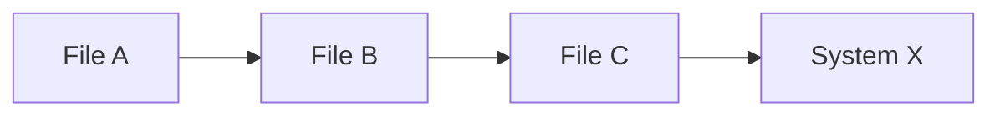
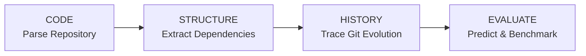
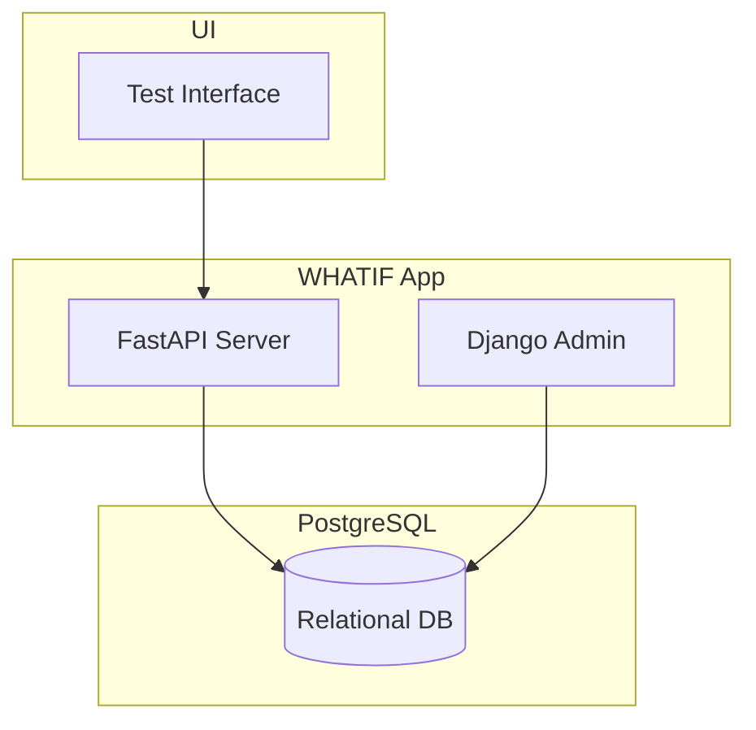

<div align="center">
  <h1>WHATIF</h1>
  <p><strong>Software Change Impact Analyzer</strong></p>
  <p><em>Analyze code. Understand dependencies. Predict impact honestly.</em></p>

  <p>
    
    
  </p>
</div>

---

## What is WHATIF?

**WHATIF** is a research-oriented software engineering project aimed at analyzing software change impacts.
This foundation provides an intelligence layer over your codebase to understand structural dependencies and historical evolution.

---

## The Problem

When a developer modifies a function or file, it's often difficult to foresee exactly what else in the software ecosystem will break or change behavior.



When a change happens, developers need to quickly determine:
- Which files rely on this component?
- Have these files historically changed together?
- What is the true scope of the impact?

---

## The WHATIF Approach

Our core workflow helps developers evaluate code changes:

**CODE → STRUCTURE → HISTORY → EVALUATE**

- 🔍 **CODE:** Accept and parse a Git repository.
- ⚖️ **STRUCTURE:** Analyze code structure (Python/JS ASTs).
- 🎯 **HISTORY:** Track Git history and symbol-level changes.
- ♻️ **EVALUATE:** Generate hypothetical change impacts and run quantitative benchmarks.

### Core Workflow Diagram



---

## Core Features

| Feature | Description |
| :--- | :--- |
| 🕸️ **Structural Graph** | Extract files, functions, classes, and imports. |
| 🕰️ **Git History** | Track commits and individual file additions/modifications. |
| 🎯 **Symbol Tracking** | Track how individual symbols (e.g., Python AST nodes) evolve. |
| ⚡ **Hypothetical Impact** | Combine structural and historical evidence for impact prediction. |
| 📊 **Batch Benchmarking** | Quantitatively evaluate impact prediction across multiple commits. |

---

## Tech Stack


- **Backend:** FastAPI (API & Analysis), Django (Admin Interface)
- **Database:** PostgreSQL with SQLAlchemy & Alembic
- **Testing:** Pytest

---

## Architecture



---

## Setup

1. Copy `.env.example` to `.env`:
   ```bash
   cp .env.example .env
   ```

2. Start PostgreSQL using Docker Compose:
   ```bash
   docker-compose up -d
   ```

3. Setup Python Virtual Environment & Install Dependencies:
   ```bash
   python3 -m venv .venv
   source .venv/bin/activate
   pip install -r requirements.txt
   ```

### Database Migrations

Apply Alembic migrations to setup the schema:
```bash
export PYTHONPATH=$PWD
alembic upgrade head
```

### Running the Applications

**FastAPI:**
```bash
export PYTHONPATH=$PWD
uvicorn backend.fastapi_app.main:app --reload
```

**Django Admin:**
```bash
cd backend/django_app
python manage.py createsuperuser
python manage.py runserver 8080
```

### Tests
```bash
export PYTHONPATH=$PWD
pytest backend/tests/
```

---

## Milestone Evolution

### M1-M3: Structure & History
- Analyzes basic Python AST extraction and simple JS regex.
- Connects Git history to code semantics.
- Generates structural dependencies and historical co-changes.

### M10: Batch Research Benchmarking
M10 extends the single-commit evaluation into a deterministic batch benchmark. It answers:
*"Does combining structural dependency evidence with historical co-change evidence provide better impact coverage than either evidence source independently?"*

**Workflow:**
```text
Historical Commits
        ↓
Deterministic Source Selection
        ↓
┌──────────────┬──────────────┬──────────────┐
│ Structural   │ Historical   │ Combined     │
│ Impact       │ Impact       │ WHATIF       │
└──────────────┴──────────────┴──────────────┘
        ↓
Actual Historical Changes
        ↓
TP / FP / FN
        ↓
Precision / Recall / F1
        ↓
Aggregate Benchmark Results
```

**Methods Compared:**
| Method | Evidence | Description |
|---|---|---|
| Structural | Dependency graph | Uses deterministic reverse dependency traversal |
| Historical | Git co-change history | Uses historical files that changed alongside the source |
| Combined | Structural + historical | Uses the existing WHATIF hypothetical-change analysis |

**API Example:**
`POST /api/repositories/{repository_id}/benchmark`
```json
{
  "limit": 10,
  "max_depth": 5,
  "historical_limit": 50
}
```

---

## Known Limitations
- Analysis is currently limited to basic Python AST extraction and simple Regex for JS.
- Git history collection can be slow for extremely large repositories.
- Only Python is officially supported for deep AST symbol-level structural analysis.
- Zero-denominator cases in metrics return 0.0.

---

<div align="center">
  <p>◼ <strong>WHATIF</strong></p>
  <p>Analyze code. Understand dependencies. Predict impact honestly.</p>
  <p>Hackathon 4.0 · 2026</p>
</div>
